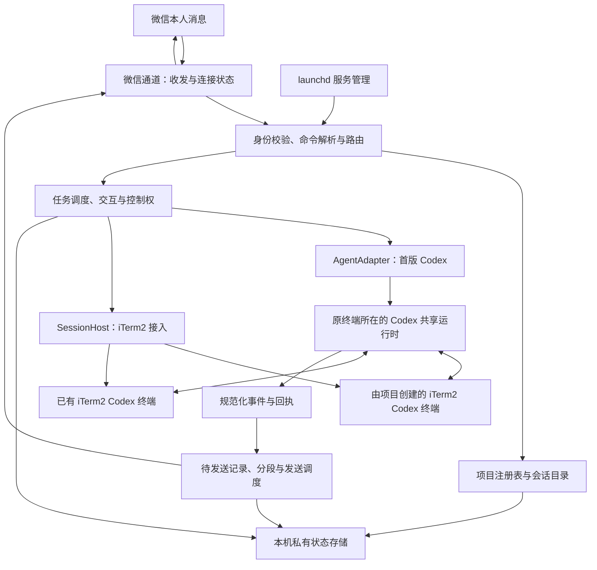

# 微信本地 Agent 工作台：架构设计

本文保存设计与验收要求；实际进度与验证状态以仓库 ROADMAP.md 为准。

项目名：wx-clawbot；用户已创建目录 `<project-root>/`。本文是面向用户需求的新设计，不是博主源码的还原或实现完成声明。

配套产品文档：[产品设计](product-design.md) 。原始参考：[四张截图整理稿](reference/architecture-from-screenshots.md) ，以及随后补充的会话指令截图。

工程入口：[技术选型](technical-decisions.md) 、[开发契约与接口验证](development-contracts.md) 、[施工清单](../goals/implementation-plan.md) 。本文负责系统边界；具体版本、接口与关卡以这些文档为准。未通过关卡的能力不得表述为已实现。

## 1. 需求与证据边界

### 已确认需求

- 使用微信操作本机多个项目，guixu 只是其中一个，业务项目继续保存在原目录。
- 首版只适配 Codex；结构上允许未来接入其他 Agent，不在首版实现多 Agent 协作。
- 桥接服务不自动修改现有 Codex 全局配置；初始化的具体例外授权以项目 AGENTS.md 为准。
- 博主方案符合用户需求，本文围绕实现该交互体验补齐工程契约。

### 2026-10-24 问答确认的六项使用决策

| 编号 | 已确认内容 |
| --- | --- |
| D01 | 首版接入 iTerm2 中已有的 Codex 会话；One 不作为首版宿主 |
| D02 | 原终端继续运行，微信作为远程入口，两端使用同一个会话 |
| D03 | 既能切换已有会话，也能通过微信选择本机项目、在 iTerm2 启动新的 Codex 会话 |
| D04 | 会话忙碌时，微信与桌面专用入口共用 daemon 队列；停止、查询和交互答复立即处理；原 TUI 按键保持原生语义 |
| D05 | 审批和追问在微信与电脑两端同步展示，只接受首次有效答复，并同步已处理状态 |
| D06 | 首批真实验收项目为 guixu 与新建的 wx-clawbot；先通过临时项目测试，再按具体任务授权验收 |

本项目与 openclaw-local 完全独立；禁止读取、参考、复用或修改其代码、配置、凭据和服务，不安排关联迁移或退役。

### 新截图直接给出的命令

| 命令 | 别名 | 截图原意 |
| --- | --- | --- |
| `/sessions [关键词]` | `/ss [关键词]` | 退出聚焦并刷新或筛选会话 |
| `/send <序号> <指令>` | `/s <序号> <指令>` | 让原终端单次执行 |
| `/focus <序号>` | `/f <序号>` | 持续聚焦原终端 |
| `/unfocus` | `/uf` | 退出聚焦 |
| `/attach <序号>` | `/a <序号>` | 接管会话 |
| `/detach` | `/ua` | 退出接管 |

上述表格是截图证据；下文的状态机、排队、审批、恢复、目录规则和接管契约属于本方案的设计建议。截图没有定义 attach 的底层实现、进程归属和桌面端可否同时输入，不把这些细节写成博主实现事实。

## 2. 设计决策与未决边界

1. 按项目、Agent 会话、终端端点、任务四层建模。切项目不等于切终端，切目录不等于迁移旧会话上下文。
2. 区分两种会话来源：已在 iTerm2 运行的 Codex，以及由微信请求在 iTerm2 新启动的 Codex。后者称受管会话，表示创建和生命周期归属，不意味着独立后台会话；两类都需支持电脑与微信操作同一上下文。
3. `/focus` 保留原终端执行归属。本人已确认 `/attach` 是独立观察订阅，不改变 focus，不引入排他控制或后台迁移；第 7 节定义边界。
4. 原终端接入是首版核心，宿主明确为 iTerm2。需验证发现、定向输入、状态观察、两端审批和新会话启动；不能以另开后台 thread 替代原会话功能。
5. 首版只实现 CodexAdapter；未来扩展通过显式能力声明，不把所有 Agent 都包装成 ACP。
6. 核心采用 Python 与 asyncio，使用 iTerm2 官方 Python SDK 管理宿主；微信层按腾讯公开客户端协议实现最小文本适配器。具体依赖经过原型测试后锁定，不复制截图的 50 层补丁，也不部署完整 OpenClaw Gateway。
7. 运行状态使用标准库 sqlite3，普通配置采用 JSON。SQLite 用于消息、任务和待发送记录的一致更新；JSON 适合低频配置。这是独立桥接项目的状态存储，不向 guixu 引入数据库。
8. Codex 优先连接原终端所在共享运行时，原生队列负责实际调度，桥接账本负责关联与恢复。接口选择须通过 V01 至 V04；不并行建设一套与原生队列竞争的执行调度。

## 3. 系统结构



建议代码职责：`channel/wechat` 管通信；`commands` 管确定性命令；`projects` 管目录与规则入口；`sessions` 管目录、选择和控制权；`tasks` 管调度与恢复；`agents/codex` 管协议；`hosts` 管原终端；`delivery` 管回执；`state` 管持久化；`service` 管生命周期。职责模块可以同进程运行，不拆成微服务。

图中共享运行时是首选技术路径，尚未代表现场已有会话均满足条件。独立运行时会话必须单独识别并验证接入；不能自动重启或迁移。实际 Python 目录结构见开发契约。

业务项目不承载桥接程序、会话账本或凭据。通过原项目目录读写业务文件，遵守对应项目规则。

## 4. 核心数据模型

| 对象 | 关键字段 | 不变量 |
| --- | --- | --- |
| Project | project_id、alias、canonical_root、rule_sources、enabled | 注册路径真实解析；别名唯一；不是权限沙箱 |
| Session | session_id、project_id、agent_kind、native_thread_id、cwd、origin、host_ref、capabilities | 一个会话固定归属一个项目；Agent 原生 ID 不用列表序号代替 |
| TerminalEndpoint | host_kind、endpoint_id、process_identity、session_id、capabilities | 窗口标题不作为唯一身份；进程与端点重用后需重新核验 |
| Route | owner、mode、selected_session_id、observed_session_id、revision | 执行模式为 unbound／managed／focused，观察订阅独立保存；每个微信绑定各自保存 |
| SessionList | list_id、owner、created_at、expires_at、index_to_session_id | 序号只属于该次列表快照；刷新后旧映射不能误命中新会话 |
| Task | task_id、source_message_id、project_id、session_id、route_revision、turn_id、state | 接收时固定路由；执行中切换焦点不改投递目标 |
| Interaction | request_id、task_id、kind、options、expires_at、state、runtime_generation、resolved_by | 两端共用请求身份与首次有效答复状态；进程重启后的旧请求不可继续授权 |
| Outbox | event_id、task_id、recipient、sequence、content、delivery_state | 执行状态与送达状态独立；重发结果不重跑任务 |

Codex 保留原生会话历史；桥接账本只保存必要映射、待执行输入和用于恢复送达的结果，不复制整套原生历史。已完成任务正文与回执建议保留 7 天，终态摘要建议保留 30 天；这些是待确认默认值，程序仅清理自己管理的账本内容，不删除业务文件或 Codex 原生历史。

## 5. 项目、目录与上下文

- 本机注册明确允许接入的项目根目录；首版不自动导入所有仓库或全部私人会话。项目新增、移除配置不等于移动或删除项目。
- `/cd <项目别名或目录>` 选择注册范围内的执行目录。相对路径基于当前选中目录解析；无当前目录时要求项目别名或绝对路径。
- 路径存在、可访问、解析符号链接后仍在许可范围内才生效；失败保持原路由。重叠项目采用最深明确注册根，注册时提示重叠。
- `/cd` 默认进入 managed 模式，优先复用该项目和目录最近使用的受管会话，没有则创建。多个候选无法唯一确定时列出候选。
- 跨项目或改变会话目录时使用另一会话；不把旧 thread 原地改到新项目。回到原项目可恢复其会话。
- `/cd` 不向原终端 Shell 注入拼接字符串，也不改变服务进程全局 cwd；需要新会话时通过核验后的 iTerm2 启动接口传递目标目录及参数。执行目标变化不自动取消独立观察订阅。
- 会话创建、恢复和每轮执行前核对规则入口与版本；由 Codex 的原生指令加载机制负责主要加载，桥接端核验来源并补充项目导航。规则变化需让后续轮次读取新版本，不能只在首次初始化缓存。
- guixu 的索引、去重、入库和测试只是其项目规则，不硬编码为所有项目都必须执行的流程。

## 6. 命令与路由契约

命令使用固定语法解析，别名等价。未知 slash 命令返回帮助，不当 Shell 执行；自然语言任务交给选中的 Agent。项目别名与会话序号属于不同命名空间。

| 命令 | 本方案行为 |
| --- | --- |
| `/projects` | 列出已注册项目及可用状态 |
| `/cd <目标>` | 按第 5 节选择目录及受管会话；成功回显项目、路径、会话与模式 |
| `/sessions [关键词]`、`/ss` | 退出 focused 模式，再刷新／筛选可访问会话；关键词匹配项目别名、目录或会话标题 |
| `/send <序号> <指令>`、`/s` | 向列表中的原终端会话单次派发，不改变持久焦点；目标不支持原终端发送时明确拒绝，不新建另一会话冒充成功 |
| `/focus <序号>`、`/f` | 聚焦支持原终端输入和结果观察的会话；之后普通消息持续发给它，原终端继续运行 |
| `/unfocus`、`/uf` | focused → unbound；不终止任务；不恢复更早焦点，避免消息误投 |
| `/attach <序号>`、`/a` | 独立订阅该会话后续桌面主动任务的进展、结果及交互；不改变执行目标，原生订阅确认后才成功 |
| `/detach`、`/ua` | 只取消观察订阅，保留执行目标、既有任务和原终端；已接收任务结果与必要交互仍按原关联投递 |
| `/new [标题]` | 在当前项目与目录通过 iTerm2 创建受管 Codex 会话，注册并选中；启动失败不留下伪可用会话，不改变其他会话内容 |
| `/status [任务ID]` | 显示当前模式、项目、会话，以及运行／排队／等待交互／送达状态 |
| `/stop [任务ID]` | 有唯一当前活动任务时可省略 ID，否则列出候选；排队任务直接取消，活动任务发送取消请求；只收到终态证据后报告停止 |
| `/approve <请求ID>`、`/deny <请求ID>` | 仅处理展示给本人的、未过期的具体请求；approve 默认一次性许可，不暗中扩大为永久许可 |
| `/answer <请求ID> <回答>` | 回答明确关联的追问；多题单选与自由文本按原生问题 ID 和选项校验，同题复选后置 |
| `/help` | 返回命令、别名和当前可用能力 |

列表有效期建议 10 分钟，超时要求刷新；无论有效期如何，提交时都复验原生会话与端点身份。序号只映射稳定 session_id；消息按同一账号的接收序列处理，解析时冻结当前列表及 route revision，避免异步处理产生串会话。

没有选中目标时，普通消息提示先选项目或会话，不自动猜测项目。有待审批时，裸“可以”只提示使用带请求 ID 的命令，不擅自匹配其他任务。

## 7. 原终端与接管的实现边界

SessionHost 是宿主连接接口，独立于 AgentAdapter。首版 iTerm2 宿主负责发现、启动和校验端点；提交、结构化输出、忙碌状态、交互答复和中断由 CodexAdapter 提供，两者通过可靠身份映射组合成用户会话。attach 是观察订阅，不新增排他控制权获取／释放。

原终端路径优先使用宿主或原进程已有的正式接口。仅当宿主没有结构化入口时才评估终端输入输出适配；必须能确认当前运行的是目标 Codex、端点仍有效、输入不会落入普通 Shell。仅“发送了一段文本”不能算任务成功。

聚焦模式允许桌面端继续使用原终端，但忙碌时微信任务排队；宿主必须能检测真实占用，无法检测时不自动注入。结果来源须关联具体任务，不能把终端屏幕残留当成此次结果。

旧草稿提出过排他接管，这是未确认假设，不作为当前验收要求。用户选择原终端持续运行且两端均可处理交互；不能据此加入强停终端、后台迁移或桌面长期只读要求。

`/attach` 与 `/detach` 已按本人选择采用独立观察订阅，细则见[命令契约](command-contract-proposal.md)。每个微信绑定最多一个观察目标，替换订阅时明确回显；订阅失败保留原状态，不用本地标记冒充真实订阅。

本轮已经明确 iTerm2，不再将宿主选择交回用户。剩余为技术验证：同一原生会话识别、原终端输入与输出、桌面端主动答复感知，以及两端几乎同时答复时的竞争处理。

## 8. Codex 适配与未来扩展

内部接口只围绕已经存在的需求：`capabilities`、`listSessions`、`openSession`、`resumeSession`、`startTask`、`observeEvents`、`respondInteraction`、`cancelTask`、`closeOwnedRuntime`。会话跨 Agent 迁移和多 Agent 自动编排不进入首版。

规范化事件包括 accepted、progress、interaction_required、completed、failed、interrupted、disconnected。所有事件携带 project_id、session_id、task_id；原协议字段保留在适配器内部。能力不足返回明确 unsupported，不能返回伪成功。

CodexAdapter 通过本机 Unix WebSocket 连接既有共享运行时，核对线程、任务、事件、审批和中断接口。本项目必须操作 iTerm2 中真实会话；具体连接仍需原型验证，不能因接口存在就认定另启 app-server 能控制已有 TUI。新会话也须在 iTerm2 可见可用。仅回收本服务拥有的代理连接，不自动关闭用户终端；断开连接与结束原会话分开处理。

本项目与 openclaw-local 完全独立；禁止读取、参考、复用或修改其代码、配置、凭据和服务，不安排关联迁移或退役。

未来添加 Agent 时，仅新增适配器、能力映射和契约测试；增加新的终端宿主时，仅新增 SessionHost 实现。不同 Agent 不共享原生 thread ID，不承诺跨模型自动迁移历史。

## 9. 调度、执行状态与交互

首版建议最多两个项目任务同时运行，同一会话严格串行；等待审批占用该会话控制权。项目规则要求单写入者时，调度器对该项目串行，不凭模型说“只读”就开放并发。

项目占用按真实目录与 Git 公共仓库标识判断，嵌套路径及同仓库 worktree 按更严格范围处理。桥接锁只覆盖本服务管理的任务；对外部编辑器或其他 Agent，必须有宿主协作或人工交接，不能宣称全机文件锁。

按 D04，普通新任务在目标忙碌时排队；建议每会话最多 10 条，超出返回队列已满，不丢弃旧任务。停止、状态查询及审批／追问答复绕过普通任务队列。切换焦点不迁移既有队列。优先以原生队列协调桌面与微信，桥接器不向 TUI 输入区争写文本；原生队列接口为实验能力，关联、顺序与恢复必须通过 V04。

首版经本人确认采用 [桌面专用排队入口](desktop-queue-contract.md)：电脑在普通 Shell 使用 `codex queue`，桥接使用相同 daemon／thread 的队列接口。原 TUI 持续显示执行与交互，空闲可继续对话；其忙碌时 Enter／Tab 不属于统一队列入口。客户端适配后置，保留旧按键反例供后续决策。

```text
received → submitting → queued → running → completed / failed
                                  ↕ waiting_interaction
running / waiting_interaction → cancelling → interrupted
submitting / running / cancelling → outcome_unknown（断连后无法确认）
queued → cancelled（尚未执行）
```

submitting 在发送给 Agent 之前持久化。若提交成功与 queue／turn ID 落盘之间崩溃，标记 outcome_unknown 并核对原生记录，不盲目重放。queued 表示已被原生队列接收；桥接账本不再次派发。任务 completed 只表示 Agent 轮次结束，回执另列验证结果，不能推断所有测试或 Git 推送成功。

审批与追问按 request_id、task_id、运行代次和发送者绑定；建议 10 分钟超时，超时拒绝／取消并返回可理解状态。断线和重启使旧审批失效。若当前 Agent 不能安全结束等待，则标记未知并阻止后续任务，等待核对。

按 D05，交互在微信和电脑同步展示，首次有效答复完成原子状态转换并提交一次，另一端更新已处理。电脑原生答复可能绕过桥接账本，因此需要原生请求完成事件或共享裁决入口，不能仅凭本地数据库锁宣称双端互斥。提交结果不确定时核对原生状态，不将另一答复作为自动重试；覆盖同意与拒绝同时到达、超时边界和断线后迟到答复。

项目授权规则继续生效：明确指令覆盖的行为不重复提出业务确认，底层执行权限请求仍通过正式审批接口处理。规则提示与沙箱各自生效，不能以字符串拦截充当完整命令安全边界。

## 10. 消息与执行可靠性

接收入库、去重键和消息游标在同一本机事务中提交后，才将任务交给调度器。微信账号、会话与稳定消息 ID 组成去重键；实际通道提供什么字段需在适配前核验，字段缺失不得伪称具备可靠去重。

结果写入 Outbox 与任务终态关联；内容分段带项目、任务、段号。发送成功只依据通道可提供的回执等级，不把服务端受理等同手机已读。超时不确定时保留 delivery_unknown；若重试造成重复消息，任务 ID 和段号便于识别，但绝不重新执行任务。

审批、失败、最终结果优先于高频进展。建议 5 秒以上合并进展消息；配额数值以真实通道能力为准，不照搬截图“每入站 10 条”。最终结果超长时分页留存，可通过状态入口取回，不静默截断关键错误。

Markdown 格式化只作用于展示；命令、代码、路径、URL 和引用保持原义。中文排版在渲染层确定性处理。无外部通知 HTTP API 也能完成首版任务回执，首版不为它新增公网入口。

## 11. 本机部署与数据边界

源码目录已明确为 `<project-root>/`。私有运行目录设计为 `~/Library/Application Support/wx-clawbot/`，保存 config.json、state.sqlite3、logs、secrets、runtime；源码仓库只保留脱敏模板、代码、测试与文档。当前没有创建运行目录或部署服务。

launchd 负责单实例常驻与有限退避重启；本机管理 CLI 提供 start、stop、status、doctor。应用自身检查消息循环及 Agent 连接健康；有实际需要再增加独立 watchdog，避免双重重启风暴。

微信只允许已绑定本人账号，入站与出站都核验身份。密钥、真实身份、消息和任务正文留在私有运行目录，不进入 Git；凭据文件使用受限权限。桥接复用现有模型访问路径，不等于模型离线，任务上下文仍可能发送到模型服务。

本项目与 openclaw-local 完全独立；禁止读取、参考、复用或修改其代码、配置、凭据和服务，不安排关联迁移或退役。

停服务先停止接收新任务并报告活动任务，按授权决定等待或取消；不自动杀死非本服务拥有的终端。电脑睡眠、断网时显示不可达，恢复后核对游标和原生任务状态，不承诺离线继续运行。

## 12. 性能、可观测性与测试

下列是设计目标，不是测量结果：正常负载下，消息到达本机后，控制命令本地处理 p95 小于 1 秒；Agent 执行不阻塞命令解析；默认最多两个活动执行单元，队列、结果和日志均有上限。通道传输、模型耗时和审批等待分别统计，不混为本机性能。

日志关联 message_id、project_id、session_id、task_id、request_id 和运行代次；默认记录状态、错误分类及耗时，不输出凭据或完整项目正文。doctor 只读检查进程、通道、Codex 版本／协议、宿主能力、目录、权限和待恢复任务。

验证分三层：命令、路由与状态单元测试；Codex／iTerm2 契约与故障注入测试；本人微信＋真实 Codex＋至少两个临时项目的端到端验收。随后以 guixu 和 wx-clawbot 完成按任务授权的真实项目验收；选择验收项目不等于授权任意修改。沙箱 fixture 测试不能代替真实终端、手机收发或权限隔离测试。

核心验收矩阵以产品文档为权威入口。实现前先验证原终端身份、输入、输出与控制权，避免核心交互到最后才发现缺适配。

## 13. 实施顺序与交付边界

1. 以 D01 至 D06 和技术文档为输入，维护工程规范、依赖锁与已确认的独立观察订阅契约，不重复询问已确认使用方式。
2. 验证已有 iTerm2 Codex 会话的单次执行／聚焦、微信启动新会话、排队、两端审批首次答复及取消的最小技术链路。
3. 实现多项目注册、会话目录、命令及路由快照；补齐原生历史恢复和项目规则加载。
4. 实现任务串行、去重、Outbox、故障恢复和诊断；完成产品验收。
5. 按实际完成状态编写 README 与 ROADMAP，再决定部署替换和版本发布。

本文只定义设计；交付与部署状态见 [ROADMAP](../ROADMAP.md)。

## 14. 来源与待确认项

- 用户两轮明确需求与五张截图：需求和参考交互的一手输入。
- [Codex App Server 官方文档](https://learn.chatgpt.com/docs/app-server) ：本轮核对其本地通信、线程、任务、审批与中断接口；方法和字段须再以实施时本机版本生成的 schema 校验。接口存在不证明外部终端已提供同等控制能力。
- 已定技术方向与本机检查结果见技术决策；原终端映射、共享运行时双端交互、原生队列和微信文本闭环的实际验证状态以 ROADMAP 为准。attach 已确认独立观察订阅，数值默认值在施工关卡中校准；改变已确认用户体验时再确认。

实施核对：`app-server proxy` 仅透传原始字节，不能直接写 JSONL。Unix 控制 socket 使用 WebSocket；桥接直连该 socket，不新建运行时。见 [官方固定源码](https://github.com/openai/codex/blob/970111f6cb62cc02fe36a82ea7d71b37a2889c97/codex-rs/stdio-to-uds/src/lib.rs)。
