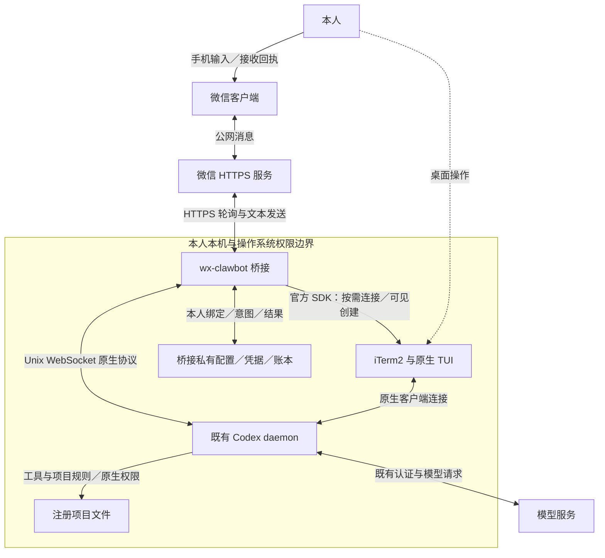
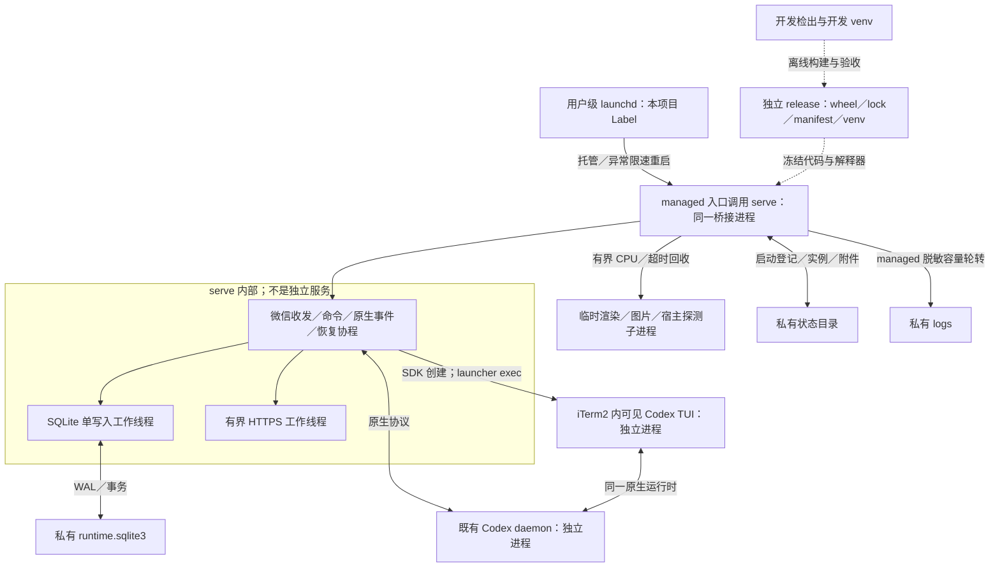
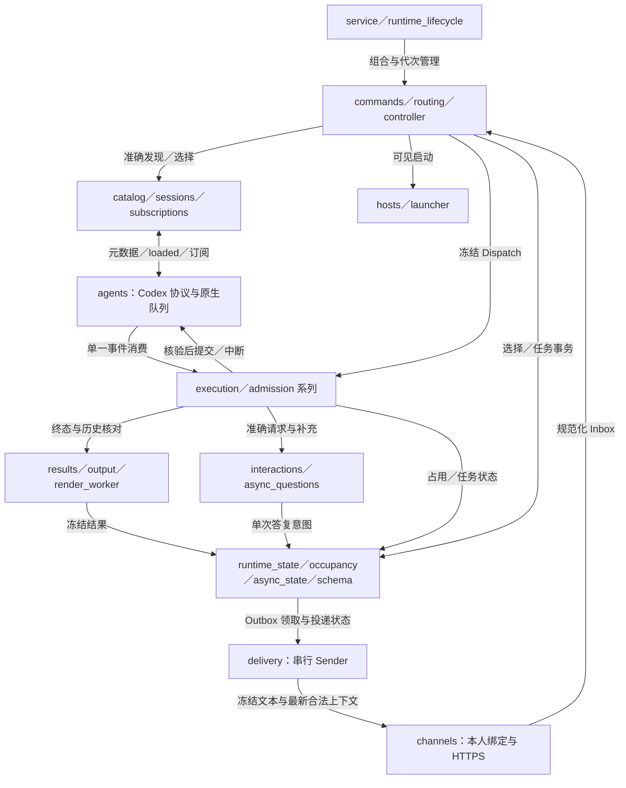
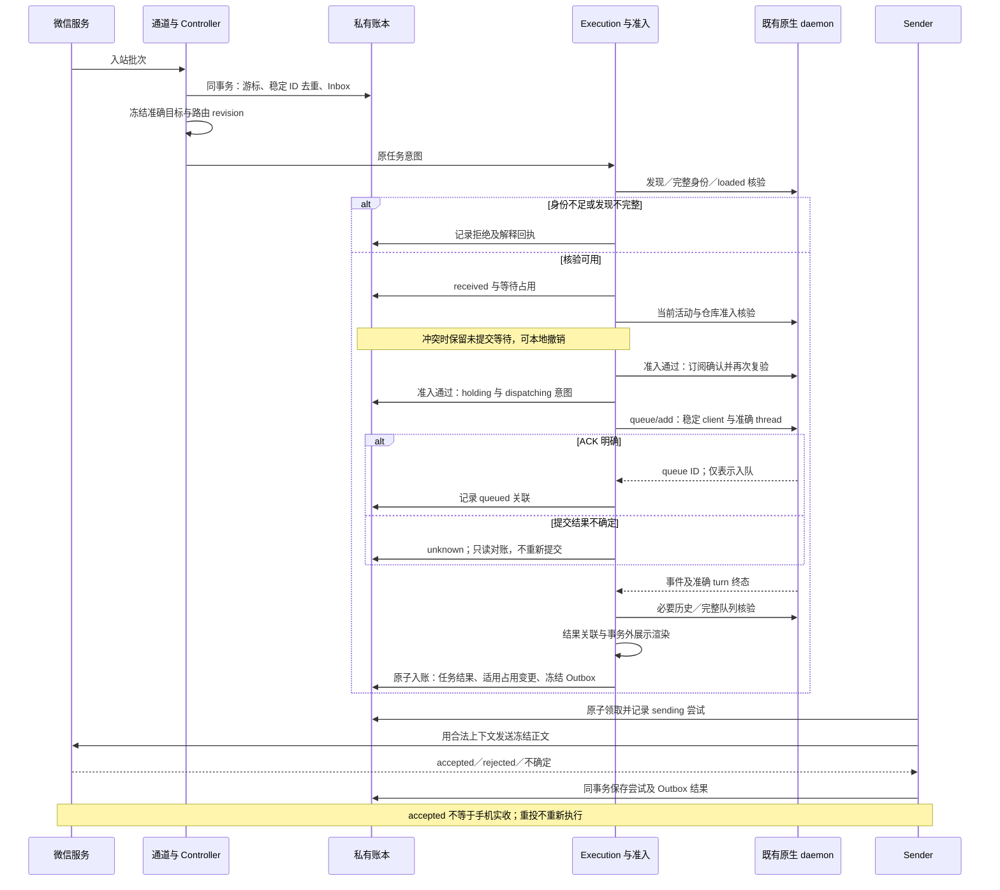
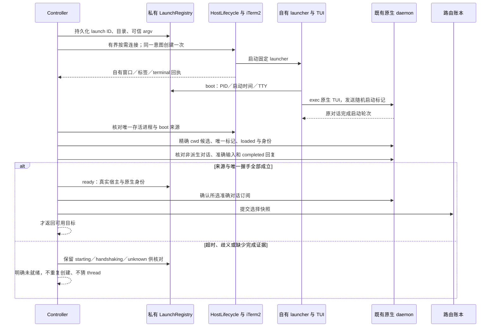

# wx-clawbot 当前架构

本文描述应用 0.1.9 的实际结构；状态见 [ROADMAP](../ROADMAP.md)，产品要求见 [PRD](product-design.md)，接口和关卡见[开发契约](development-contracts.md)。采用 [arc42](https://arc42.org/overview/) 的上下文、模块、运行、部署、质量视角，并参考 [C4](https://c4model.com/diagrams) 分层；不是标准认证，也不要求 Docker 或微服务。

图中实线是有标签的数据／调用关系，虚线是管理、来源或非运行依赖。模块图的节点是逻辑模块；部署图才表示进程边界。Mermaid 为唯一图形维护源，渲染检查见 [DOC01 报告](validation/documentation-restructure.md)。旧设计输入和反例保留固定提交及历史记录，不视为当前路径。

## 1. 需求与证据边界

系统服务本人微信和本机多个注册项目，只实现 Codex。核心质量约束为准确原生身份、接收时冻结目标、未知不重放、执行与送达分离。外部原生运行时、模型和微信服务不受桥接控制；目录登记不提供操作系统沙箱。项目与其他桥接服务独立，不读取其他项目代码、凭据或服务。

原生身份、宿主来源与显示界面分开。既有对话使用项目限定的原生元数据、完整 loaded 集合及订阅确认；iTerm2 用于可见新建和可选 cwd／来源证据。后台对话不被宣称对应某个当前显示窗口。版本与证据层级以[协议矩阵](protocol-baseline.md)为准。

## 2. 设计决策与未决边界

| 策略 | 当前选择与后果 | 依据 |
| --- | --- | --- |
| 同一原生对话 | 连接既有 daemon，不复制历史／恢复存档；微信选择不随桌面改变 | [身份契约](native-session-identity.md) |
| 最小本机服务 | Python asyncio、标准库 HTTPS／SQLite、官方 iTerm2 SDK | [ADR](technical-decisions.md) |
| 原生执行权威 | daemon 队列调度；本地仅持久化意图、准入和关联 | [桌面排队](desktop-queue-contract.md) |
| 可靠交付 | SQLite 原子事务配合 Outbox，跨系统 RPC／HTTP 不确定性保留 unknown | [账本](state-schema.md) |
| 独立选择和观察 | focus／managed 输入与 attach 观察分别保存 | [命令契约](command-contract-proposal.md) |
| 运行隔离 | 非 editable 独立 release，父子 manifest 一致 | [运维](operations.md#eng01独立运行制品与开发隔离) |

已知限制由专题和 ROADMAP 维护：外部客户端写入不能被桥接锁住，原生规则不保证逐轮刷新，异步不保证首答独占，暂停队列不自动恢复；不以添加复杂框架回避这些限制。

## 3. 系统结构

### F01：系统上下文与信任边界

[查看独立 SVG](diagrams/architecture-F01.svg)。派生图只从下方 Mermaid 重新生成，不单独维护事实。

范围：本人手机、外部微信服务及同一用户的本机。公网服务与原生 daemon／TUI 均为外部依赖；桥接只管理自身资源。

桥接不提供模型额度，不复制 Codex 历史；任务正文和图片可能经原生路径到模型服务。目录注册与用户绑定限制路由范围，不能代替原生权限或系统隔离。

### F02：运行进程与部署

[查看独立 SVG](diagrams/architecture-F02.svg)。派生图只从下方 Mermaid 重新生成，不单独维护事实。

范围：正式运行。开发检出不进入生产导入路径；launchd 只托管本项目，Codex daemon／iTerm2 的生命周期由用户及其原生机制管理。

`managed.py` 在同一进程调用 CLI 的 serve 入口并管理日志，不另建服务进程或微信消费者；`ForegroundInstance`／消费者锁核对实例。直接前台 serve 不经过 managed 日志入口。SQLite 工作线程和 HTTPS 工作线程不等于额外常驻服务。可见 launcher 的进程回执证明创建来源，后续 `exec` 运行原生 TUI；不托管或自动重启该 TUI。

### F03：模块协作

[查看独立 SVG](diagrams/architecture-F03.svg)。派生图只从下方 Mermaid 重新生成，不单独维护事实。

范围：serve 内部的逻辑职责。图简化辅助调用，准确入口在下表；所有持久化状态共用同一账本执行器。

| 职责 | 实现入口 | 不跨越的边界 |
| --- | --- | --- |
| 通道／媒体 | `channels/wechat.py`、`messages.py`、`media.py` | 不选择 thread，不执行项目工作 |
| 固定命令／目录／路由 | `commands.py`、`config.py`、`routing.py`、`controller.py` | 不用模型猜目标，不向普通 Shell 注入任务 |
| 发现／身份／订阅 | `catalog.py`、`sessions.py`、`subscriptions.py` | 不读页脚，不 resume notLoaded，不伪造宿主 |
| 可见宿主 | `hosts/lifecycle.py`、`hosts/visible.py`、`launcher.py` | 自有启动意图至多一次，不清理用户资源 |
| 原生适配 | `agents/codex.py`、`rpc.py`、`queue.py` | 校验实际 server 版本／socket，不另建运行时 |
| 执行／准入／恢复 | `execution.py`、`admission.py`、`admission_recovery.py`、`admission_ops.py` | 原生队列权威，unknown 不重放，结果不等同占用 |
| 交互 | `interactions.py`、`async_questions.py` | 同步裁决与异步补充分开，不擅自授权 |
| 结果／展示／发送 | `results.py`、`output.py`、`render_worker.py`、`delivery.py` | 事务外渲染、入账后冻结，重投不执行任务 |
| 账本／维护 | `runtime_state.py`、`occupancy.py`、`async_state.py`、`schema.py`、`retention.py` | 单执行器，显式迁移／维护，不覆盖新数据 |
| 生命周期／制品 | `service.py`、`runtime_lifecycle.py`、`runtime_discovery.py`、`managed.py`、`release.py` | host 与 native 代次分开，正式父子来源一致 |

## 4. 核心数据模型

这里是概念关系，不是逐字段 DDL。Project 来自配置，CatalogSession 来自发现，Routes 是内存状态及 JSON 快照；不意味着存在 projects／sessions 表。当前 13 表和实际对象／接口分别见[账本](state-schema.md)及[开发契约](development-contracts.md)。

| 概念 | 标识与不变量 |
| --- | --- |
| Project／cwd | 真实解析的注册根与目录，别名唯一，重叠范围选择最深注册根 |
| 原生绑定 | runtime socket 设备／inode、完整 thread、native session、规范 cwd；可选真实宿主来源 |
| Route／列表 | 输入与观察分别选择；数字序号只在当前列表有效，任务接收时冻结完整目标 |
| Task／占用 | client／queue／turn 关联执行；waiting／holding／released 独立审计 |
| Interaction | 同步请求绑定原代次，异步问题绑定准确 turn／item；新输入须复验 |
| Outbox／尝试 | 最终结果和投递分离，冻结正文；HTTP 意图与结果持久化，未知不自动重试 |

## 5. 项目、目录与上下文

项目文件留在原目录。`/cd` 对 realpath、权限和范围校验，失败保留原选择；合法目录没有受管会话时可见新建，不把旧 thread 原地改到另一项目。已有对象发现限定注册根和已知准确 cwd，不递归磁盘或抓取全部私人历史。

微信选择不随桌面变化；新输入必须复验准确原生对象。关闭窗口可能使原生仍加载，也可能卸载，不能提前承诺。只读历史核验可以恢复准确结果，却不授予新路由资格。[身份契约](native-session-identity.md)集中维护预算、稳定编号和旧快照兼容。

规则由 Codex 原生机制加载；桥接核验身份和 cwd，不保证热更新、规则变化检测或自动阻断。[规则责任](project-rules.md)给出用户已接受的限制。各业务项目自身规范不硬编码到桥接。

## 6. 命令与路由契约

固定语法、独立观察、显式目标、旧快照失效及全部命令由[命令契约](command-contract-proposal.md)维护。接收时冻结目标与 revision，后续切换不改投。切换先取得原生订阅确认再提交路由快照；落库／订阅失败不能报成功。

### F04：既有对话执行与结果时序

[查看独立 SVG](diagrams/architecture-F04.svg)。派生图只从下方 Mermaid 重新生成，不单独维护事实。

范围：已绑定本人、明确目标的正常任务；示意事务边界，外部调用不位于 SQLite 事务中。

## 7. 原终端与接管的实现边界

原路径保留此标题供旧读者查找；现行 attach 是独立观察，没有排他接管。既有对象不要求宿主证明当前显示；可见创建才要求真实进程来源。桥接不争写 TUI 输入区，桌面忙碌任务使用[专用队列入口](desktop-queue-contract.md)。

### F05：可见新建与准确握手

[查看独立 SVG](diagrams/architecture-F05.svg)。派生图只从下方 Mermaid 重新生成，不单独维护事实。

范围：合法 `/cd` 需要创建，或有当前目录的 `/new`。iTerm2 授权、窗口出现、原生握手和选择提交是四个不同事实。

## 8. Codex 适配与未来扩展

`AgentAdapter` 是当前小型 Protocol，实际方法见[开发契约](development-contracts.md)。Codex 特有的队列、交互和历史方法保留在具体实现，不宣称所有能力已统一为可插拔框架。未知版本和缺少能力明确拒绝；不安装第二真实 Agent，不承诺跨 Agent 历史互通。

## 9. 调度、执行状态与交互

原生队列负责执行，桥接准入负责防止本服务在同项目／Git common directory 的冲突。received 等待尚未提交；提交前记录 dispatching，ACK 不明保留 unknown。任务、占用、同步交互、异步问题和投递有不同状态机，不能合为一个 running／success；准确状态表见[开发契约](development-contracts.md)与[账本](state-schema.md)。

同步请求以原生 resolved 裁决，十分钟只限制微信迟到回答；异步使用原 turn 的 steer，可能同时接收外部答案。通知沿已核验订阅关联，新任务与异步答案仍完整复验身份，不因弹窗遮住状态栏重新发现。

## 10. 消息与执行可靠性

Inbox、去重与游标原子接收；任务意图先持久化再调用外部协议；最终结果与冻结 Outbox 原子入账；每次发送前记录尝试。RPC／HTTP 和 SQLite 不具备跨系统事务，unknown 是保留真实不确定性，不是重试信号。

发送串行且按优先级、分段前序约束推进；关键回执优先，旧进展淘汰。展示仅处理新结果，不改变任务输入、原生历史或旧冻结回执。媒体下载和解码在有界子进程，不能阻塞控制路径或跨任务共用正文缓存。

## 11. 本机部署与数据边界

开发检出与独立 release 分离。私有状态默认位于用户的 `Library/Application Support/wx-clawbot/`，保存配置、凭据、账本、launch 登记、附件与受限日志；代码仓库只保留模板和脱敏证据。桥接仅托管本项目 Label，不管理 Codex／iTerm2，不自动安装登录项。

通道在 host／native 缺席时继续提供帮助、项目和状态，依赖恢复另行复验。正常停止保留原生任务；重启不重放 unknown、不沿用旧数字列表。发布、备份、schema 兼容及代码回退／数据恢复分离见[运维](operations.md)。

## 12. 性能、可观测性与测试

事件循环处理 I/O 与控制，阻塞 SQLite／HTTPS 在有界工作线程。`ResultWork` 同 thread 保序、跨 thread 有界推进；大结果使用临时进程，取消等待实际回收。当前渲染阈值与容量以实现及[排版专题](wechat-markdown.md)为准；PERF01 当时的阈值只适用于其测量基线。

native 事件只有一个 Execution 消费者；明确无用的文本增量可丢弃，关键事件、请求、终态和 resolved 保留上界保护。发送唤醒是优化提示，持久状态仍由账本决定。诊断只输出安全分类及必要关联，不放开原始异常正文来排障。

质量场景：桌面切换保持原目标；换代撤销旧资格；提交边界崩溃保留未知；结果投递失败不重跑；超限明确拒绝；依赖缺席不拖垮微信控制。对应单元／契约、真实原生和手机验收见[测试指南](testing.md)。本地 p95 基准不等于模型或公网 SLA。

## 13. 实施顺序与交付边界

原 W00 至 W08 施工顺序保留在[初始计划](../goals/implementation-plan.md)，后续按独立 Goal 演进。当前架构页不保留待实现叙事；下一步以 ROADMAP 为准。文档整改不升级产品、不运行真实测试或部署。

## 14. 来源与待确认项

实现入口以本页模块表、源码及现有测试为依据；需求来自 PRD、AGENTS 和已确认契约，外部 schema 来源见协议基线。无法保证的外部行为保留限制，不能用通用官方文档替代本机匹配版本证据。[ADR](technical-decisions.md)记录关键取舍和重新评估条件。

## REC01：结果与占用分离契约

结果 unknown 不等于永久 holding。释放依赖准确终态、完整提交／队列、原生代次及审计；窗口消失、超时或空队列不能单独释放。只读历史核验不授予新路由；合并输入可使结果继续未知而占用按严格证据结束。详见[准入与账本](state-schema.md)。

## ASK01 已确认施工契约

异步补充沿同一账本、准确订阅和原 turn steer 实现，无第二消费者；跨端可同时接受。严格辅助输入关联、证据状态及恢复规则见[异步契约](async-questions.md)。
