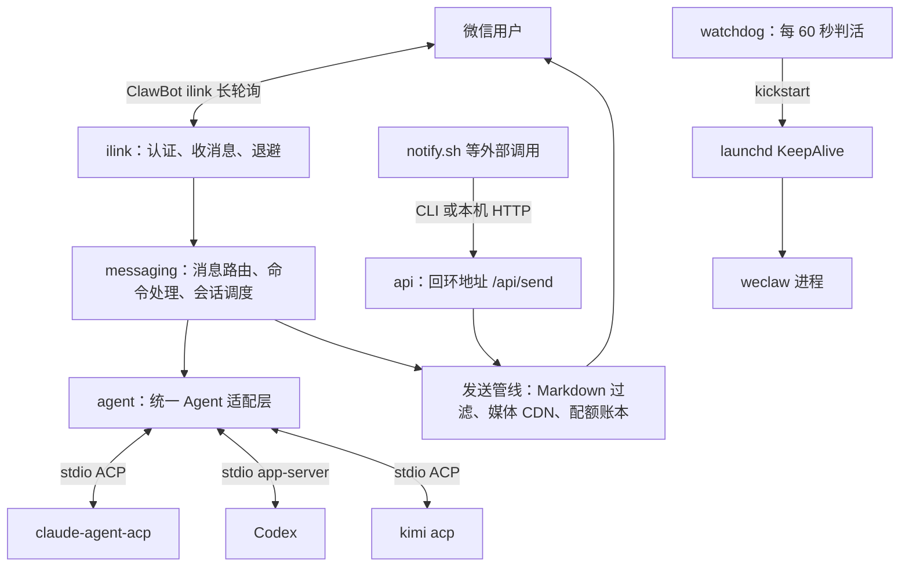

# wx-clawbot 整体架构整理

> 来源：用户提供的直播截图；仅作为参考证据，不代表完整源码或已验证技术事实。
> 本文是截图内容整理，不是源码审计或运行验收报告。截图中的架构说明由演示时的 Agent 输出，模块规模、机制和效果仍需源码核验。截图未展示 OpenClaw Gateway。

## 1. 项目定位

wx-clawbot 是一个把微信消息接入本地 CLI Agent 的桥接与会话管理项目，以 weclaw 为核心进程，连接 Claude、Codex、Kimi，并将执行结果回传微信。

## 2. 整体架构



本机 HTTP 地址在截图中为 `127.0.0.1:18011`。ilink、messaging、agent、api 与发送管线属于 weclaw 进程内部；Agent 是通过标准输入输出连接的本地子进程。

虽然适配层命名为 ACPAgent，截图明确区分 Claude／Kimi 的 ACP 与 Codex 的 app-server，不应把三者统称为相同协议。

纯文本链路：

```text
微信用户
  ↕ 微信 ClawBot ilink 长轮询
weclaw：ilink → messaging → agent 适配层
                              ├─ stdio ACP → claude-agent-acp
                              ├─ stdio app-server → Codex
                              └─ stdio ACP → kimi acp
执行结果 → messaging → 统一发送管线 → 微信

notify.sh 等外部程序 → CLI／本机 HTTP API → 同一发送管线 → 微信
launchd KeepAlive → weclaw；watchdog 每 60 秒判活并通过 kickstart 恢复
```

## 3. 核心模块

截图标题为「核心分层（vendor/weclaw，约 1.4 万行 Go）」。规模仅按截图记录，没有独立统计。

| 模块 | 截图标注规模 | 职责 |
| --- | ---: | --- |
| ilink | 1,064 行 | 微信 ClawBot 协议客户端；扫码授权、长轮询收消息、context_token 缓存、退避和 32 并发信号量；缓存相关内容标注为 PR #68 的核心。 |
| messaging | 7,183 行，最大模块 | 入站消息路由；内建命令表，包含 /sessions、/attach、/cd 等 20 多个命令、别名与保留词；跨 Agent 会话调度；终端注入 /send、/focus；配额账本；官方 Markdown 过滤器移植；iTerm2 活跃会话检测。 |
| agent | 3,947 行 | ACPAgent 统一适配三种 Agent 协议形态，截图原文为「legacy ACP／Codex app-server」；会话槽位、fork 回收、崩溃自愈，后者标注为第 49 层补丁。 |
| cmd | 1,216 行 | CLI 入口 start、stop、send、doctor、installation；截图称「强制 ACP 红线在这里机器化校验」，具体规则未展开。 |
| installation | 1,048 行 | 受管生命周期；版本 staging、激活、回滚事务；launchd 服务归属。 |
| diagnostics／setup／api／config | 未单列 | doctor 只读诊断、安装渲染与防注入、本机回环 API、配置原子写入。 |

配额原文为「每入站 10 条出站＋保留槽」，截图没有给出完整计算、刷新或回收规则。

## 4. 仓库结构

```text
wx-clawbot/
├── vendor/
│   └── weclaw/             # 核心 Go 程序
│       └── PATCHES/        # 50 层补丁链
├── scripts/                # 安装、升级、卸载、备份、通知、守护
├── config/                 # 程序配置模板与 launchd plist 模板
├── tests/                  # 沙箱隔离测试
└── docs/                   # CLI、生命周期和排错契约
```

- `vendor/weclaw/PATCHES/`：截图称维护 50 层补丁链，可从上游 v0.7.1 逐层重放并进行零差异校验。
- `scripts/`：安装、升级、卸载、备份、notify、watchdog，同时承载产品契约，例如「notify 恒 exit 0」。
- `config/`：配置模板与 plist 模板，服务 label 按用户名渲染。
- `tests/`：沙箱隔离测试，不接触真实服务或微信。
- `docs/`：cli-contract、lifecycle、troubleshooting 是行为依据。

截图没有提供上游仓库地址，无法仅凭截图确认补丁来源、授权许可、公开情况或合入上游状态。

## 5. 两条消息链路

### 5.1 微信发起任务

1. 用户在微信发送指令。
2. ilink 接收消息。
3. messaging 处理命令、路由到对应会话。
4. agent 适配层与本地 Agent 通信。
5. 本地 Agent 处理任务。
6. 结果经过统一发送管线回到微信。

截图实例为「帮我看下当前项目架构」。终端出现对应任务、命令执行记录和架构输出；微信随后展示相应内容。第一张图还展示此前 commit 指令的提交回执。这是演示画面证据，没有独立核对实际 Git 提交。

### 5.2 外部程序主动通知

1. notify.sh 等外部程序发起调用。
2. 通过 CLI 或本机 HTTP /api/send 进入服务。
3. 复用发送管线，将通知发送到微信。

截图明确说明：入站任务产生的回复与外部通知共用发送管线和配额账本。

## 6. 进程、可靠性与数据处理

- 后台守护：launchd KeepAlive 维护 weclaw 进程；watchdog 每 60 秒判活，通过 kickstart 恢复。
- 子进程生命周期：Agent 子进程由 daemon 根 ctx 管理。
- 会话管理：会话槽位、fork 回收与崩溃自愈；恢复粒度和上下文保留方式未展开。
- 落盘：配置、绑定、账本、游标采用 temp + rename 原子写入。不能据此推断多文件事务或断电持久性保证。
- 敏感数据：截图称微信 ID 只存哈希，凭据权限为 0600；具体范围和实现未核验。
- 版本维护：staging、激活、回滚流程，以及可重放补丁链。

## 7. 截图能够支持的能力与边界

设计覆盖微信收发、本地 Agent 接入、项目与会话操作、执行结果回传、主动通知、后台守护、安装升级和诊断。

微信指令进入本地 Agent、结果回到微信是截图展示的核心闭环。以下事项仍待源码与真实任务核验：

- /attach 如何关联已有会话，是否无缝接续终端当前上下文。
- 执行审批如何在微信展示、确认、拒绝和超时。
- 多会话同时操作一个项目时如何避免冲突。
- 全局与项目 AGENTS.md 如何加载。
- 停止任务、断线恢复、消息去重和结果送达的具体机制。
- tests 中的沙箱隔离是否也对应生产执行时的权限隔离。
- iTerm2 检测与终端注入是否适配其他桌面工作台。
- 不修改既有 Codex 全局配置的具体启动与安装方式。

本文仅整理截图，未安装或运行该项目，没有修改任何现有服务或 Codex 配置。
